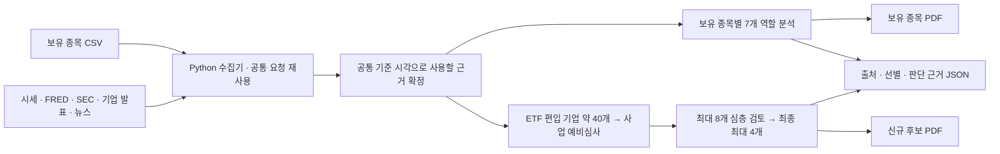
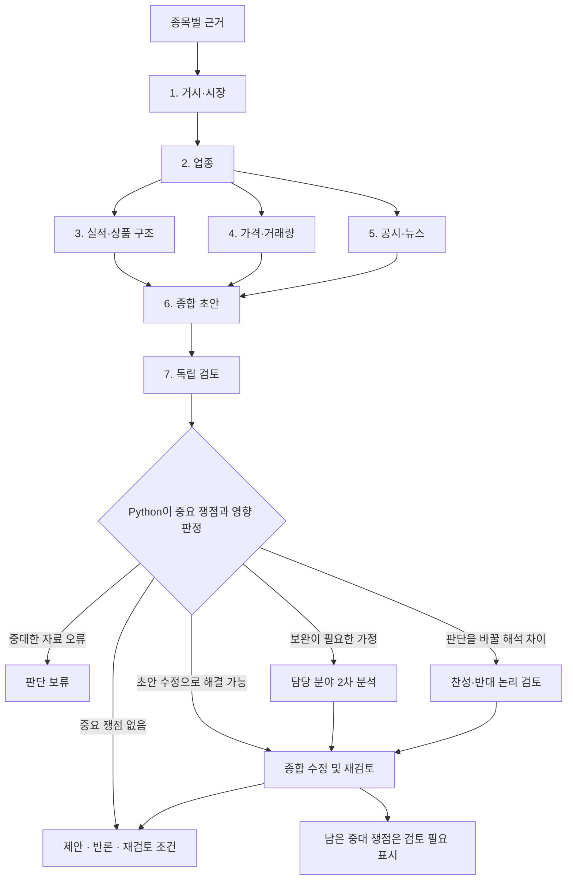

# Market Thesis Lab

공개 시장 데이터·공시·뉴스를 바탕으로 **보유 종목의 대응과 새로 살펴볼 투자 후보**를 검토하는 미국 신규 후보와 미국·한국 보유 종목을 다루는 리서치 프로토타입입니다. 보유 종목 CSV 하나를 입력하면 같은 기준 시각으로 보유 분석과 신규 후보 발굴을 실행하고, 결론과 반론, 다시 판단할 조건을 한국어 보고서로 정리합니다.

- **보유 종목** — 거시경제와 업종 흐름, 회사 실적 또는 ETF 구조, 주가·거래량, 최근 사건을 검토합니다.
- **신규 후보** — 미국 섹터 ETF 4개의 상위 편입 기업 약 40개를 대상으로 사업 자료를 검토하고, 최대 8개 심층 검토 후 최종 최대 4개 기업을 고릅니다. 기간별 최대 2개이며 자료가 부족하면 자리를 채우지 않습니다. 유동성은 거래 가능성 조건으로 사용하고 사업·전략·실증·가격 가정·반론으로 선별합니다.
- **실행 기록** — 두 PDF와 함께 출처, 자료 시점, 모델 입력·출력, 분기와 토큰 사용량을 근거 JSON에 보관합니다. 투자 보고서에는 운영 사용량을 표시하지 않으며, 비교·점검 보고서는 요청할 때 별도로 만듭니다.

## 빠르게 시작하기

Python 3.11 이상, 인터넷 연결, 한국어 TrueType 글꼴이 필요합니다. 전체 분석에는 **로그인된 Codex CLI**가 필요하며, `--collect-only`는 모델 호출 없이 실행됩니다. 기본 모델은 `gpt-6.1-sol`이고 계정에 맞는 모델을 `--model`로 지정할 수 있습니다.

```sh
python -m venv .venv
```

Windows PowerShell에서는 `.\.venv\Scripts\Activate.ps1`, macOS·Linux에서는 `source .venv/bin/activate`로 환경을 활성화합니다.

```sh
python -m pip install -r requirements.txt
python -B -m research_prototype.integrated --holdings research_prototype/examples/usa.csv --output-dir runs/demo-collect --collect-only
python -B -m research_prototype.integrated --holdings research_prototype/examples/usa.csv --output-dir runs/demo
```

출력 경로는 새 디렉터리를 사용합니다. PDF는 Windows의 맑은 고딕과 Linux의 표준 Nanum Gothic 설치 경로를 찾습니다. 다른 경로에 설치한 경우 환경 변수 `RESEARCH_PDF_FONT`에 한글 TTF 파일 경로를 지정하세요. SEC 접근이 거절되면 `SEC_USER_AGENT`에 식별 가능한 프로젝트명과 연락처를 로컬 환경에서 설정할 수 있습니다.

CSV의 필수 열은 `ticker`입니다. 선택 열 `held`를 `false`로 넣으면 해당 행을 건너뜁니다. 저장소에 포함된 CSV는 공개 종목으로 만든 실행 예제입니다.

| 생성 파일 | 내용 |
| --- | --- |
| `holdings.pdf` | 보유 종목별 제안, 주요 사건과 시장 반응, 반론, 재검토 조건 |
| `discovery.pdf` | 기간별 신규 후보, 사업과 업종 전망, 최근 이슈와 고려할 위험 |
| `holdings.md`, `discovery.md` | 같은 결과의 텍스트 버전 |
| `evidence.json` | 원문 링크와 발췌, 관측·수집 시각, 선별 근거, 역할별 입력·응답·검토 기록 |

`--collect-only`는 Markdown과 근거 JSON을 저장합니다. 준비 상태를 빠르게 확인하거나 외부 데이터 소스를 점검할 때 사용합니다.

## 시스템 구조



Python이 공개 자료 수집, 공통 요청 재사용, 날짜와 근거 검증, 거래 가능성 확인, 분석 경로 선택을 맡습니다. LLM은 각 역할에 필요한 근거만 받아 해석합니다. 역할 간에는 자유 대화 기록 대신 **근거 ID와 구조화된 결과**가 Python 상태를 통해 전달됩니다. 신규 후보의 사업 예비심사와 심층 분석은 제한된 배치 호출로 수행합니다.

### 보유 분석의 7개 역할



시장·업종 분석이 뒤 단계의 배경을 제공합니다. 실적·가격·뉴스는 각각 별도 역할이며 현재 실행기는 이 역할들을 순서대로 호출합니다. 공시와 뉴스의 사건 시점, 공개 시각, 수집 시각을 구분합니다. 비교 가능한 확정 일봉이 있으면 사건 전후에 종목과 시장이 어떻게 움직였는지 함께 표시합니다.

## 재실행과 검증

```sh
python -B -m research_prototype.integrated --replay runs/demo/evidence.json --output-dir runs/demo-replay
python -B -m unittest discover -s framework_validation/tests -v
python -B -m unittest discover -s research_prototype/tests -v
```

재실행은 저장한 기준 시각, 정량 자료, 후보 순위를 사용합니다. 과거의 기업 발표나 외부 뉴스는 날짜를 검증한 URL 목록을 `--event-sources`로 지정할 수 있습니다. 사업 심층 분석만 실패했다면 `--retry-business-deep <evidence.json>`으로 성공한 단계와 정확한 실패 입력을 재사용할 수 있습니다. 구형 정량 후보 주석의 재시도는 `--retry-discovery`입니다. [실행 옵션](research_prototype/README.md)

## v0.1 뉴스 재평가

일반 `integrated --holdings`는 새 시세·공시 수집과 기존 분석 흐름을 실행합니다. 추가 공개 뉴스 수집은 후단 흐름에 있으므로, 새 뉴스 원문을 모든 기초 분석 전에 넣는 경로와 같지 않습니다. 검증한 뉴스 개선 경로는 저장된 정량 자료와 후보를 유지하는 명시적 `news_context` → `news_reanalysis` 실행입니다. 기사별 관련 역할에 본문·출처 품질을 전달하고, 중요성·채택 여부·재검토 이유를 기록합니다. 제목·개인 의견을 사실 확인이나 직접 거래 근거로 승격하지 않습니다. [수집·재평가·실패 재개 명령](research_prototype/README.md#뉴스-원문을-기초-분석에-반영하는-재평가)

## 지원 범위

미국은 일봉·SEC·FRED 등 공개 자료를, 한국 보유 종목은 지원되는 시세와 날짜가 확인된 공식 자료를 사용합니다. 한국 정규장 검증이나 ETF 순자산가치·분배금 재투자 수익률처럼 확인하지 못한 항목은 별도로 표시하며 필요한 판단을 보류합니다. 레버리지·인버스·커버드콜 ETF에는 기업 실적 대신 상품 구조와 시장별 기준을 적용합니다. 신규 후보는 사업 근거에 따른 추가 조사·관찰 대상이며 목표가나 높은 기대수익을 보장하지 않습니다. 자료 제공처 차단과 미지원 자료의 공백을 결과에 기록합니다.

사용자 입력은 로컬 CSV로 받습니다. 은행·증권사 계정 연동이나 주문 기능은 포함하지 않습니다. 개인 보유 내역, 인증 파일, 생성 보고서, 실행 로그는 저장소 밖에서 관리하세요. 실행 JSON에는 분석 입력과 응답이 있으므로 공유 전에 내용을 확인하세요.

## 코드와 참고 프로젝트

| 폴더 | 역할 |
| --- | --- |
| `research_prototype/` | 공개 데이터 수집, 보유 분석, 신규 후보 발굴, 보고서 및 재실행 |
| `framework_validation/` | 역할별 분석 흐름, 분기 검증, 모의 테스트와 공개 고정 자료 |
| `tradingagents_benchmark/` | 같은 SOXL 근거로 비교하는 선택 도구. 별도로 받은 TradingAgents 체크아웃과 해당 도구의 추가 의존성이 필요합니다. |

보고서 구조와 역할 구분을 설명하는 방식은 [TradingAgents](https://github.com/TauricResearch/TradingAgents), [FinRobot](https://github.com/AI4Finance-Foundation/FinRobot), [AI Hedge Fund](https://github.com/virattt/ai-hedge-fund)의 공개 문서를 참고했습니다.
